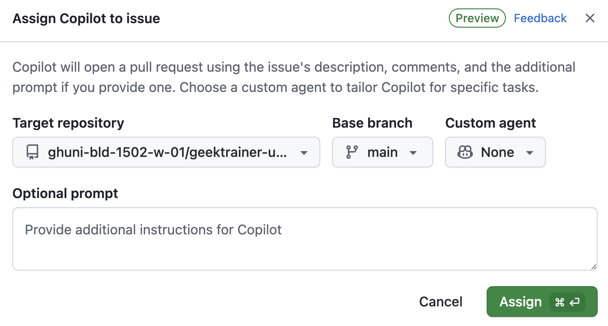

| [← Lección anterior: Instrucciones personalizadas][previous-lesson] |
|:--|

Es probable que muy pocas organizaciones —si es que hay alguna— no tengan problemas con la deuda técnica. Puede tratarse de problemas de seguridad sin resolver, código heredado que necesita actualizarse o solicitudes de funcionalidades que llevan tiempo en el backlog porque no ha habido tiempo para implementarlas. El agente en la nube de GitHub Copilot está diseñado para realizar tareas como actualizar código y añadir funcionalidades de forma autónoma. Cuando termina, genera una solicitud de incorporación de cambios (PR) en borrador para que la revise un desarrollador. Así, puedes delegar tareas tediosas, acelerar el desarrollo y dedicarte a cuestiones de mayor alcance.

Con el agente en la nube de Copilot explorarás:

- cómo personalizar el entorno de generación de código;
- cómo asegurarte de que las operaciones se realicen de forma segura;
- por qué es importante delimitar claramente las incidencias;
- cómo asignar incidencias a Copilot.

## Escenarios

Tailspin Toys tiene deuda técnica que quiere resolver. Los contratistas que crearon la primera versión del sitio dejaron la documentación en mal estado: comprobarás que no hay documentación. Como primer paso, el equipo quiere añadir comentarios de documentación TSDoc a todas las funciones exportadas de la aplicación.

Además, el equipo de diseño quiere mejorar la búsqueda de juegos. Quiere mostrar juegos relacionados —otros títulos de la misma categoría— en la página de detalles de cada juego para que los usuarios puedan seguir explorando. No necesita una implementación refinada todavía; solo quiere algo que pueda utilizar para realizar pruebas de aceptación de la experiencia de usuario. Este trabajo bloquea otras tareas, pero hay incidencias con mayor prioridad.

Estas son tareas que pueden quedar relegadas con facilidad y que conviene asignar al agente en la nube de Copilot. El agente puede trabajar en ellas de forma asíncrona mientras el desarrollador se ocupa de otras tareas y, después, puede revisar el trabajo para confirmar que cumple las expectativas.

## Presentación del agente en la nube de GitHub Copilot

El [agente en la nube de GitHub Copilot](https://docs.github.com/copilot/concepts/agents/cloud-agent/about-cloud-agent#overview-of-copilot-cloud-agent-formerly-copilot-coding-agent) puede trabajar en segundo plano de forma parecida a un desarrollador. Al igual que con una persona, puedes asignarle trabajo de varias maneras, por ejemplo, [asignándole una incidencia de GitHub](https://docs.github.com/copilot/how-tos/use-copilot-agents/cloud-agent/start-copilot-sessions). Después de la asignación, Copilot crea una solicitud de incorporación de cambios en borrador para realizar un seguimiento del trabajo, prepara un entorno y empieza a trabajar en la tarea. Puedes consultar la sesión de Copilot mientras está en curso o una vez finalizada. Cuando la solución esté lista para que la revises, Copilot te mencionará en la solicitud de incorporación de cambios.

## La importancia de delimitar bien las instrucciones

GitHub Copilot no hace magia: no elimina la necesidad de pensar. Incluso las tareas aparentemente sencillas pueden ser complejas cuando se examinan de cerca, así que [define cuidadosamente el alcance de las tareas para el agente en la nube de Copilot][cloud-agent-best-practices]. Trátalo como a un compañero de programación con IA: trabaja por etapas, aprende, experimenta y adapta el enfoque. Los fundamentos del desarrollo de software no cambian al incorporar IA generativa.

## Instrucciones personalizadas en este repositorio

En los ejercicios anteriores has visto cómo las instrucciones personalizadas orientan a Copilot. Si ya completaste el ejercicio práctico de instrucciones personalizadas, has visto `.github/copilot-instructions.md` en acción; si no, este es un buen momento para revisarlo. Antes de asignar trabajo al agente en la nube de Copilot, lee los archivos de instrucciones que ya están incluidos en el repositorio para reconocer su influencia más adelante.

Abre estos archivos en la interfaz web de GitHub o en un Codespace que ya tengas en ejecución:

- `.github/copilot-instructions.md`: revisa la sección **Code standards**, especialmente las convenciones de TypeScript y los comentarios de documentación TSDoc.
- `.github/instructions/unit-tests.instructions.md`: fíjate en el frontmatter `applyTo`, que aplica estas instrucciones a los archivos `**/*.test.ts`.

Cuando en la siguiente sección asignes al agente en la nube la incidencia `Code lacks documentation`, fíjate en los comentarios TSDoc, las convenciones de TypeScript y los encabezados de comentarios de la solicitud de incorporación de cambios resultante. Proceden de estos archivos de instrucciones. Volveremos a señalarlo al revisar las PR en un ejercicio posterior.

## Configurar el entorno de desarrollo del agente en la nube de Copilot

Crear código suele requerir un entorno específico y algunos scripts de configuración para dejarlo preparado. Lo mismo ocurre al asignar tareas a Copilot, que trabaja de forma parecida a un ingeniero de software.

El agente en la nube utiliza [GitHub Actions][github-actions] como entorno de trabajo. Puedes personalizarlo mediante un [flujo de trabajo de configuración especial][setup-workflow], definido en `.github/workflows/copilot-setup-steps.yml`, que se ejecuta antes de que el agente empiece a trabajar. Así, puede acceder a las herramientas y dependencias de desarrollo necesarias. Para facilitar el taller, ya se ha configurado este flujo de trabajo. Proporciona a Copilot Node.js, las dependencias del proyecto, los navegadores para las pruebas de extremo a extremo y la base de datos SQLite migrada y sembrada de la aplicación Astro:

```yaml
name: "Copilot Setup Steps"

# Permite probar los pasos de configuración desde la pestaña "Actions" del repositorio
on: workflow_dispatch

env:
  ASTRO_TELEMETRY_DISABLED: "1"

jobs:
  copilot-setup-steps:
    runs-on: ubuntu-latest
    # Establece los permisos mínimos necesarios para *tus pasos*. Copilot recibirá su propio token para las operaciones que realice.
    permissions:
      # Si quieres clonar el repositorio como parte de los pasos de configuración, por ejemplo, para instalar dependencias, necesitarás el permiso `contents: read`. Si no clonas el repositorio en estos pasos, Copilot lo hará automáticamente cuando terminen.
      contents: read
    steps:
      - name: Checkout code
        uses: actions/checkout@v5

      # Configuración de frontend y aplicación: Node.js (ahora toda la aplicación utiliza Astro + Drizzle/libSQL)
      - name: Set up Node.js
        uses: actions/setup-node@v6
        with:
          node-version: "lts/*"
          cache: "npm"
          cache-dependency-path: "./package-lock.json"

      - name: Install JavaScript dependencies
        run: npm ci

      - name: Install Playwright browsers
        run: npx playwright install --with-deps chromium

      # Migra y carga datos iniciales en SQLite local para que las compilaciones y pruebas dispongan de datos.
      - name: Set up the database
        run: npm run db:setup
```

El archivo se parece a cualquier otro flujo de trabajo de GitHub, pero hay algunos detalles importantes:

- Contiene un único trabajo llamado `copilot-setup-steps`. Se ejecuta en GitHub Actions antes de que Copilot empiece a trabajar en la solicitud de incorporación de cambios.
- El desencadenador `workflow_dispatch` permite ejecutar manualmente el flujo de trabajo desde la pestaña **Actions** del repositorio. Esto sirve para comprobar que se ejecuta correctamente sin esperar a que Copilot lo inicie.

## Añadir documentación

Aunque todo el mundo reconoce la importancia de la documentación, muchos proyectos tienen información desactualizada o carecen de documentación. Este tipo de deuda técnica suele quedar desatendida, reduce la productividad y dificulta mantener el código o incorporar a nuevos desarrolladores. Copilot puede ayudar a crear documentación, por lo que esta es una buena incidencia para asignarle al agente en la nube. El agente trabajará en segundo plano y, en un ejercicio posterior, revisarás el resultado.

1. En una nueva pestaña del navegador, ve al repositorio en github.com.
2. Selecciona la pestaña **Issues**.
3. Selecciona **New issue** para abrir el cuadro de diálogo de nueva incidencia.
4. Selecciona **Blank issue** para crear una incidencia en blanco.
5. Escribe `Code lacks documentation` en **Title**.
6. Escribe lo siguiente en **Description**:

   ```plaintext
   Our organization has a requirement that functions and methods include TSDoc doc comments where helpful. Unfortunately, recent updates haven't followed this standard. We need to update the existing code to ensure doc comments are included where they clarify behavior.
   ```

7. Selecciona **Create** para crear la incidencia.
8. En el lado derecho, selecciona **Assign to Copilot** para abrir el cuadro de diálogo de asignación.

   

9. Selecciona **Assign**.

   

10. Selecciona la pestaña **Pull Requests**.
11. Abre la solicitud de incorporación de cambios (PR) que se acaba de generar. Su título será parecido a `[WIP]: Code lacks documentation`. Si todavía no aparece, espera un momento y actualiza la ventana del navegador.
12. Al cabo de unos minutos, Copilot debería haber creado una lista de tareas.

> [!NOTE]
> La lista de tareas puede tardar varios minutos en aparecer en la PR. Copilot está preparando su entorno mediante el flujo de trabajo anterior, analizando el proyecto y determinando cómo abordar la tarea.

13. Revisa la lista y las tareas que se van a realizar.
14. Desplázate hacia abajo por la cronología de la PR; deberías ver una actualización que indica que Copilot ha empezado a trabajar en la incidencia.
15. Selecciona el botón **View session**.

   

> [!CAUTION]
> Es posible que tengas que actualizar la ventana para ver el indicador actualizado.

16. Observa la sesión en directo para ver cómo Copilot resuelve el problema: explora el código y comprende el estado del proyecto, se detiene a pensar y decidir el enfoque y, después, crea código.

Es probable que el trabajo tarde varios minutos. Uno de los objetivos principales del agente en la nube de Copilot es realizar tareas de forma asíncrona para que podamos ocuparnos de otras cosas. Aprovecharemos esa característica: mientras el agente trabaja en otra tarea, añadiremos funcionalidad a la aplicación.

## Añadir una sección de juegos relacionados a la página de detalles

Una de las ventajas del agente en la nube de GitHub Copilot es que permite dividir el trabajo: tú puedes centrarte en un conjunto de tareas mientras el agente se ocupa de otro. Añadir una sección de juegos relacionados para el equipo de diseño quizá no lleve mucho tiempo, pero ese tiempo se podría dedicar a otras tareas. Asignemos el trabajo al agente en la nube de Copilot.

1. Vuelve al repositorio en github.com.
2. Selecciona la pestaña **Issues**.
3. Selecciona **New issue** para abrir el cuadro de diálogo de nueva incidencia.
4. Selecciona **Blank issue** para utilizar la plantilla en blanco.
5. Escribe `Show related games on the game details page` en **Title**.
6. Escribe lo siguiente en **Description**:

   ```markdown
   We want to help people discover more games by showing related games on each game's details page. The design team wants to explore the UX and do some acceptance testing. Our requirements are:

   - Add a data-access helper in `src/lib/` that returns other games in the same category as a given game, excluding that game
   - Show a "Related games" section on the game details page that uses the helper
   - Handle the case where a game has no related games
   - There should be unit tests created for the new helper
   - Before creating the PR, ensure all tests pass
   ```

7. Selecciona **Create** para crear la incidencia.
8. En el lado derecho, selecciona **Assign to Copilot** para abrir el cuadro de diálogo de asignación.

   

9. Selecciona **Assign**.

Al poco tiempo, verás varios emoji 👀 en el primer comentario de la incidencia para indicar que Copilot ya está trabajando.


Copilot ya está trabajando en la segunda solicitud. El agente en la nube trabaja de forma parecida a un ingeniero de software: no es necesario supervisarlo continuamente, puedes revisar el resultado cuando termine. Ahora veremos cómo crear y utilizar agentes personalizados.

## Resumen y próximos pasos

En esta lección has explorado el [agente en la nube de GitHub Copilot][copilot-agents]. Puedes asignarle incidencias para que trabaje de forma asíncrona, por ejemplo, para resolver deuda técnica, crear funcionalidades o ayudar a migrar código de un framework a otro.

Has explorado estos conceptos:

- personalizar el entorno de generación de código;
- asegurarte de que las operaciones se realicen de forma segura;
- delimitar claramente las incidencias;
- asignar incidencias a Copilot.

Mientras el agente en la nube trabaja en segundo plano, puedes empezar a crear y utilizar agentes personalizados. [El agente en la nube de Copilot también puede utilizar servidores MCP][cloud-agent-mcp] y puede acceder a las instrucciones personalizadas que exploramos en los módulos anteriores.

## Recursos

- [Acerca del agente en la nube de Copilot][copilot-agents]
- [Asignar incidencias de GitHub a Copilot][assign-issue]
- [Prácticas recomendadas para el flujo de trabajo de configuración del agente en la nube][cloud-agent-best-practices]

| [Siguiente lección: Agentes personalizados →][next-lesson] |
|--:|

[previous-lesson]: ../1-custom-instructions/
[next-lesson]: ../3-custom-agents/
[cloud-agent-mcp]: https://docs.github.com/copilot/how-tos/copilot-on-github/customize-copilot/customize-cloud-agent/extend-cloud-agent-with-mcp
[assign-issue]: https://docs.github.com/copilot/how-tos/use-copilot-agents/cloud-agent/start-copilot-sessions
[setup-workflow]: https://docs.github.com/copilot/how-tos/copilot-on-github/customize-copilot/customize-cloud-agent/customize-the-agent-environment
[copilot-agents]: https://docs.github.com/copilot/concepts/agents/cloud-agent/about-cloud-agent
[cloud-agent-best-practices]: https://docs.github.com/copilot/how-tos/copilot-on-github/customize-copilot/customize-cloud-agent/customize-the-agent-environment
[github-actions]: https://docs.github.com/actions
